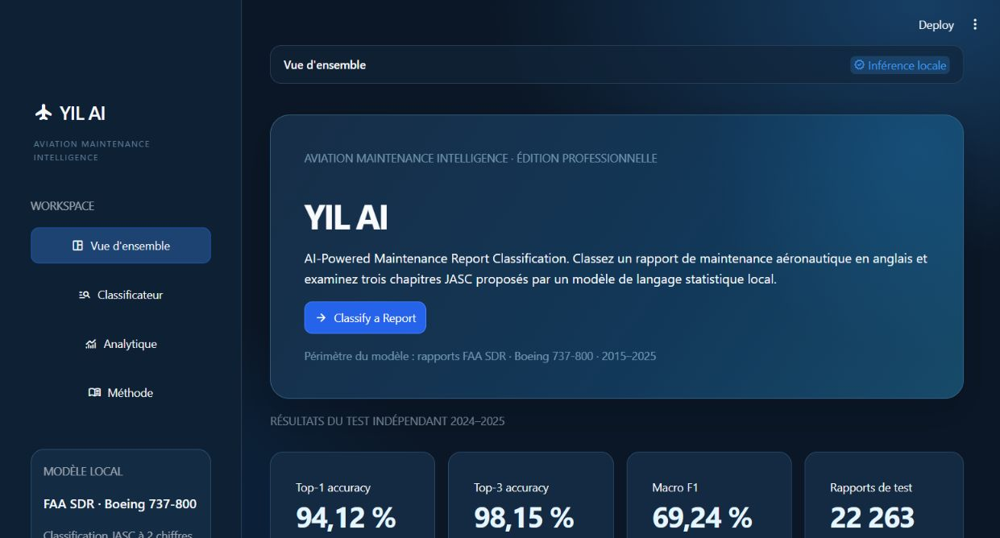
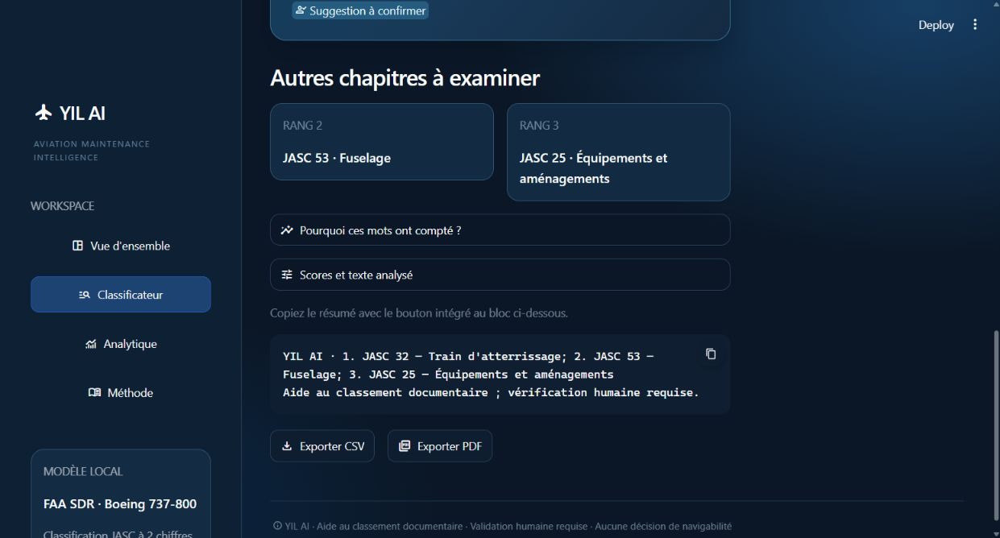

# YIL AI — Aviation Maintenance Intelligence

**AI-Powered Maintenance Report Classification**



YIL AI aide à classer **un rapport de maintenance aéronautique en anglais** dans trois chapitres JASC à deux chiffres. Le traitement repose sur un modèle local TF-IDF + LinearSVC. Il s'agit d'un prototype de **classement documentaire**, pas d'un outil de prédiction de panne, de diagnostic ou de décision de navigabilité.

Nom recommandé si le projet est publié dans un nouveau repository : `YIL-AI`. Le dossier local existant est conservé pour ne pas casser les chemins de travail.

## Résultats vérifiés

Les résultats ci-dessous proviennent de `reports/model_comparison.csv` et `reports/run_report.json`. Ce sont des mesures du jeu de test historique, **pas** des indicateurs de production en temps réel.

| Mesure | Test 2024–2025 |
|---|---:|
| Rapports de test | 22 263 |
| Top-1 accuracy | 94,12 % |
| Top-3 accuracy | 98,15 % |
| Macro F1 | 69,24 % |

Le corpus préparé comprend 76 728 rapports FAA Service Difficulty Reports (SDR) relatifs au Boeing 737-800 sur 2015–2025. La validation 2023 a servi au choix du modèle ; le modèle final a été réentraîné jusqu'à 2023 et testé sur 2024–2025. Le macro F1 plus bas que l'accuracy rappelle que les performances sont inégales entre chapitres.

## Fonctionnalités

- **Vue d'ensemble** : périmètre, workflow, exemples et métriques de test.
- **Classificateur JASC** : saisie et validation du rapport, trois suggestions réelles, scores de décision explicitement non probabilistes, termes TF-IDF contribuant positivement au premier choix, copie du résumé, exports CSV et PDF.
- **Lot CSV** : import UTF-8 (3 Mo, 200 lignes maximum), sélection de la colonne texte, statut des lignes invalides et export.
- **Historique** : dix derniers classements de la session Streamlit, restauration et effacement. Aucune persistance durable n'est annoncée.
- **Analytique** : comparaison des modèles sur la validation, performances et volumes par chapitre, couples de confusion observés. La matrice complète et les exemples d'erreurs individuelles ne sont pas disponibles dans les artefacts livrés.
- **Méthode** : source, chaîne NLP, séparation temporelle, limites et référence des **36 chapitres prédictibles** du modèle.



## Installer et démarrer

Pré-requis : Python 3.12. Les dépendances vérifiées sont épinglées dans `requirements.txt`. Depuis ce dossier :

```powershell
python -m venv .venv
.venv\Scripts\Activate.ps1
python -m pip install -r requirements.txt
python -m streamlit run streamlit_app.py
```

L'application démarre en local, généralement sur [http://localhost:8501](http://localhost:8501). Un autre port peut être choisi avec `--server.port 8507`.

## Entrée, sortie et interprétation

Entrée : description technique en anglais, par exemple `MAIN LANDING GEAR TIRE FAILED DURING TAKEOFF AND WAS REPLACED.` Sortie : trois chapitres JASC classés, avec leurs libellés et scores de décision LinearSVC. Ces scores **ne sont pas des probabilités ni des pourcentages de confiance**. Un écart faible entre les deux premiers scores déclenche un indicateur expérimental de vérification renforcée ; il ne constitue aucune garantie de sécurité.

Les termes explicatifs affichés sont calculés à partir de la contribution `TF-IDF × coefficient` de la classe proposée. Ils décrivent une influence statistique, pas le raisonnement d'un ingénieur aéronautique.

## Données et méthode

Source : [FAA Service Difficulty Reports](https://www.faa.gov/av-info/download_SDR). Cible : [chapitres JASC FAA](https://www.faa.gov/sites/faa.gov/files/JASC_Code.pdf). Le code JASC cible a été masqué dans le texte d'entraînement pour éviter une fuite directe de réponse. Le pipeline utilise un vectoriseur TF-IDF (mots et bigrammes, jusqu'à 80 000 caractéristiques) et un LinearSVC pondéré par classe. Une référence naïve et une régression logistique ont également été évaluées. La séparation temporelle est : apprentissage initial 2015–2022, validation 2023, réentraînement final 2015–2023, test 2024–2025.

Le fichier modèle `model/best_jasc_chapter_model.joblib` est celui du projet initial. Son empreinte SHA-256 est comparée à celle enregistrée dans `reports/run_report.json` **avant** chargement. Les fichiers joblib/pickle ne doivent jamais être remplacés par des artefacts de provenance inconnue. La refonte V2 n'a pas réentraîné le modèle ; le pipeline `inference.py` est inchangé.

## Structure

```text
streamlit_app.py         Point d'entrée Streamlit
app_ui.py               Pages, composants, navigation et état de session
app_services.py         Validation, inférence applicative, lots, exports et explication
inference.py            Pipeline de prédiction initial (inchangé)
model/                  Modèle et configuration de fiabilité
reports/                Métriques et manifeste d'entraînement existants
assets/                 Styles, graphiques et aperçus
tests/                  Tests UI et non-régression
```

Le thème principal est dans `.streamlit/config.toml` et les styles complémentaires dans `assets/interface.css`. Aucun service d'IA externe, compte ni clé API n'est requis pour l'inférence.

## Tests

```powershell
python -m pytest -q
python -m compileall -q app_ui.py app_services.py streamlit_app.py
```

Les tests couvrent le chargement et l'empreinte du modèle, le classement, les trois suggestions, les codes/libellés JASC, les entrées invalides, les lots CSV, les exports, la navigation et plusieurs états de l'interface. Un jeu fixe de rapports compare les prédictions V2 à celles du pipeline original. Voir `FINAL_VALIDATION_REPORT.md` pour le résultat exact de la dernière vérification.

## Limites et adaptation éventuelle au Maroc

Le modèle a été appris sur des rapports américains Boeing 737-800, principalement en anglais. Il ne peut pas être revendiqué comme validé pour d'autres flottes, d'autres langues ou un usage opérationnel au Maroc. Une adaptation demanderait un corpus autorisé et anonymisé, une taxonomie confirmée localement, une évaluation indépendante par langue/flotte/classe et une revue métier humaine. Le jeu de test contient aussi un chapitre JASC absent de l'entraînement final (14), que le modèle ne peut donc pas proposer.

**Aucune suggestion de cette application ne peut décider de la remise en service d'un aéronef.**

Code sous licence MIT. Les données FAA restent soumises aux conditions de leur source officielle.
